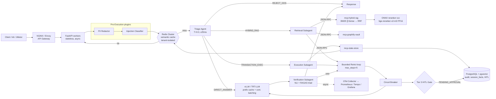

# design.md — The Unreliable Assistant → Enterprise Grade

| | |
|---|---|
| **Status** | **LOCKED** 2026-11-18 (reviewed by user). Appendix A **[DECISION NEEDED]** items default to the resolutions stated in this document. |
| **Source spec** | `Unreliable_Assistant_MidCheck_Enterprise_Blueprint_v2.docx` (18 gates) |
| **Companion artifact** | `docs/workflow_orchestration.png` (Gate 2) |
| **Read first** | Appendix A — contradictions found in the source spec and how this design resolves them. Items marked **[DECISION NEEDED]** require sign-off before lock. |

---

## 1.1 System Charter & Hard Boundaries

### Purpose
A multi-tenant, MCP-enabled agentic assistant that answers enterprise questions with **grounded, cited answers** and performs **bounded, audited actions**, replacing a prototype that hallucinated facts, looped on tools, leaked cached answers across users, drifted off-goal, and collapsed under load.

### In scope
- Query answering over tenant knowledge (policies, SOPs, product catalogs) via 3-stage hybrid RAG (BM25 + bi-encoder → RRF → cross-encoder).
- Tool use exclusively through MCP (JSON-RPC 2.0; stdio local, Streamable HTTP distributed).
- Lifecycle plugins (pre/post hooks) for PII redaction, injection defence, circuit breaking, RAGAS auditing, OTel export, HITL.
- Bounded ReAct loop with goal anchoring and context compression.
- Hash-chained audit log, tenant isolation, red-team suite, 36-KPI scorecard, Streamlit developer workbench, k6/JMeter load tests.

### Non-goals / hard boundaries
| # | Boundary | Enforcement |
|---|---|---|
| NG-1 | **No autonomous clinical, financial, or legal execution.** Any `TIER_3_MUTATE` action requires human approval. | Harness RBAC + async HITL gate (KPI-19 = 100%). |
| NG-2 | No answer without grounding. If top cross-encoder score < 0.42 the system abstains deterministically — it never "best-guesses". | Abstention short-circuit (Gate 9.3, KPI-23/24). |
| NG-3 | No cross-tenant or cross-user data exposure, including via cache. | Key namespace + `tenant_id` in every query (KPI-28 = 0 leaks). |
| NG-4 | No raw PII persisted anywhere (Postgres, Redis, logs, traces, audit). | Pre-hook redaction, fail-closed (KPI-02). |
| NG-5 | The Execution subagent has no RAG or web access; the Retrieval subagent cannot mutate state. | Per-subagent MCP binding allow-lists. |
| NG-6 | No unbounded loops: ≤ 5 iterations, no recursive self-call without state mutation. | State machine + circuit breaker (KPI-16 = 100%). |
| NG-7 | Not a general chatbot: out-of-scope queries are routed to `REJECT_OOS`. | Triage (KPI-04, KPI-06). |

### Personas
| Persona | Goal | Key interactions |
|---|---|---|
| **Enterprise Operator** (end user) | Fast, correct, cited answers; submit forms/transitions. | `/api/v1/agent/query` |
| **Authorized Reviewer** (approver) | Approve/reject Tier 3 mutations. | HITL queue (Streamlit Tab 1, approval API) |
| **Platform / SRE Engineer** | Keep p95/p99 within SLA; run incident runbooks. | Grafana/Tempo, Tab 3, Tab 6 |
| **Security Auditor / Red Teamer** | Verify isolation, injection resistance, audit integrity. | Tab 5, hash-chain verifier |
| **Developer** (hackathon mid-check) | Verify every gate live. | Streamlit workbench (Gate 18) |

---

## 1.2 MCP Tool & Data Contracts

### Transport & envelope
- JSON-RPC 2.0 (`{"jsonrpc":"2.0","id":…,"method":"tools/call","params":{"name":…,"arguments":{…}}}`).
- Every request carries `_meta` with `traceparent` (W3C), `tenant_id`, `user_id`, `session_id`, `idempotency_key` (UUIDv4), `deadline_ms` (absolute remaining budget).
- Servers **must** reject a call whose `_meta.tenant_id` ≠ the authenticated tenant (`-32006`).

### Shared types (Pydantic v2, `model_config = ConfigDict(strict=True, extra="forbid")`)
```python
SKU_RE   = r"^SKU-\d{3}$"
LOT_RE   = r"^LOT-\d{5}$"
UUID4_RE = r"^[0-9a-f]{8}-[0-9a-f]{4}-4[0-9a-f]{3}-[89ab][0-9a-f]{3}-[0-9a-f]{12}$"
ID_RE    = r"^[A-Za-z0-9_\-]{1,64}$"

class Meta(BaseModel):
    traceparent: str = Field(pattern=r"^00-[0-9a-f]{32}-[0-9a-f]{16}-0[01]$")
    tenant_id: str = Field(pattern=ID_RE)
    user_id: str = Field(pattern=ID_RE)
    session_id: str = Field(pattern=ID_RE)
    idempotency_key: str = Field(pattern=UUID4_RE)
    deadline_ms: int = Field(ge=1, le=600)

class Tier(StrEnum):
    TIER_1_READ = "TIER_1_READ"; TIER_2_COMPUTE = "TIER_2_COMPUTE"; TIER_3_MUTATE = "TIER_3_MUTATE"
```

### Tool catalogue
| Server | Tool / Resource | Tier | Purpose |
|---|---|---|---|
| `mcp-hybrid-rag` | `hybrid_retrieve` | 1 | 3-stage retrieval, returns ≤ 4 verified chunks |
| `mcp-hybrid-rag` | resource `rag://chunks/{id}` | 1 | Fetch a chunk by id (citation resolution) |
| `mcp-graphify-vault` | `graph_subgraph` | 1 | Anchor → ≤ depth-2 minimal subgraph |
| `mcp-graphify-vault` | resource `vault://notes/{id}` | 1 | Atomic Obsidian note |
| `mcp-state-store` | `get_session_facts` / `put_session_fact` | 1 / 2 | Verified facts per session |
| `mcp-state-store` | `lookup_item` | 1 | SKU/LOT lookup |
| `mcp-state-store` | `submit_form`, `transition_workflow` | **3** | Mutations → HITL |
| `mcp-state-store` | `audit_append` | 2 | Append-only, hash-chained (Verification subagent only) |
| `mcp-state-store` | `hitl_decide` | 3 | Reviewer approve/reject (reviewer role only, not callable by agents) |

### Core schemas
```python
class HybridRetrieveIn(BaseModel):
    query: str = Field(min_length=1, max_length=2000)
    top_k_sparse: int = Field(default=50, ge=1, le=100)
    top_k_dense: int = Field(default=50, ge=1, le=100)
    rrf_k: int = Field(default=60, ge=1, le=200)
    pool: int = Field(default=40, ge=4, le=100)
    rerank_k: int = Field(default=4, ge=1, le=10)
    threshold: float = Field(default=0.42, ge=0.0, le=1.0)

class Chunk(BaseModel):
    chunk_id: str; chunk_hash: str = Field(pattern=r"^[0-9a-f]{64}$")
    text: str; source_id: str; risk_tier: int = Field(ge=1, le=3)
    bm25: float | None; cosine: float | None; rrf_rank: int | None; ce_score: float

class HybridRetrieveOut(BaseModel):
    chunks: list[Chunk] = Field(max_length=10)
    top_score: float; abstain: bool            # abstain == (top_score < threshold)
    stage_ms: dict[str, float]                 # bm25, dense, rrf, rerank

class LookupItemIn(BaseModel):
    sku: str | None = Field(default=None, pattern=SKU_RE)
    lot: str | None = Field(default=None, pattern=LOT_RE)
    @model_validator(mode="after")
    def _one(self): assert (self.sku is None) != (self.lot is None); return self

class SubmitFormIn(BaseModel):                 # TIER_3_MUTATE
    form_type: Literal["safety_release","price_change","order_amend"]
    entity_id: str = Field(pattern=r"^(SKU-\d{3}|LOT-\d{5})$")
    payload: dict[str, str | int | float | bool] = Field(max_length=32)

class ToolResult(BaseModel):
    ok: bool; data: dict | None = None
    status: Literal["OK","PENDING_APPROVAL","REPAIRED","REJECTED"] = "OK"
    repaired_from: dict | None = None
    error: ErrorObj | None = None
```

### Harness pipeline (`ToolExecutionHarness`) — every MCP call, in order
1. **Strict Pydantic v2 validation** → on failure go to 2.
2. **Deterministic regex auto-repair** (no LLM): `SKU99`/`sku 99`/`SKU-99` → `SKU-099`; `lot 44`/`LOT44` → `LOT-00044`. Repair is only allowed when exactly one canonical form results and numeric width fits; re-validate; record `repaired_from` (KPI-15). Anything ambiguous → `-32602`, never guessed.
3. **RBAC tier check** against the calling subagent's role and the user's role.
4. **Idempotency**: UUIDv4 `idempotency_key` required on Tier 2/3; replay returns the stored result; same key + different args hash → `-32003`.
5. Circuit-breaker check (`(tool_name, canonical_args_hash)`), then dispatch with deadline.

### Error codes
| Code | Name | Meaning | Retry? |
|---|---|---|---|
| -32700 / -32600 / -32601 | Parse / Invalid request / Method not found | JSON-RPC standard | No |
| -32602 | INVALID_PARAMS | Failed validation after auto-repair | No (repair prompt) |
| -32603 | INTERNAL_ERROR | Unhandled server error | Once, idempotent only |
| -32001 | TOOL_TIMEOUT | Exceeded per-step/MCP deadline | Once if Tier 1 |
| -32002 | RBAC_DENIED | Tier/role violation | No |
| -32003 | IDEMPOTENCY_CONFLICT | Key reuse with different args | No |
| -32004 | BREAKER_OPEN | Circuit open → `HALTED_BREAKER` | No |
| -32006 | TENANT_MISMATCH | `_meta` tenant ≠ authenticated tenant | No (security event) |
| -32007 | PII_BLOCKED | Pre-hook fail-closed | No |
| -32008 | INJECTION_BLOCKED | Injection shield trip | No |
| -32009 | BUDGET_EXHAUSTED | Loop or deadline budget spent | No |
| -32010 | UPSTREAM_UNAVAILABLE | Dependency down (see FMEA) | Per FMEA |

`PENDING_APPROVAL` is **not** an error; it is a successful result status.

### Plugin contract (Pluggy)
Hook specs: `pre_execution(ctx) -> ctx | Block`, `tool_dispatch(call) -> call | Block`, `post_execution(ctx, draft) -> Verdict`, `all_spans(span)`. `priority` ascending; `fail_closed=true` means a plugin exception/timeout **blocks** the request. Hot-toggle is allowed for non-security plugins; `pii_redactor` and `injection_shield` cannot be disabled outside dev mode.

---

## 1.3 Distributed Topology & Data Flow

Full rendered diagram: `docs/workflow_orchestration.png` (Gate 2).



### Bulkheads (Gate 9.2)
| Pool | Size | Isolates |
|---|---|---|
| `rag_pool` | 64 | `mcp-hybrid-rag` + reranker |
| `db_pool` | 128 | `mcp-state-store` / Postgres |
| `llm_pool` | 256 | LLM calls |
| health / triage | separate event-loop lane | never starved by a slow reranker |

### Data-flow invariants
1. `tenant_id` is in **every** Postgres query predicate (enforced by row-level security *and* the query layer) and **every** Redis key.
2. Observations ≤ 180 tokens; `GoalAnchorBlock` is index 0 of every ReAct prompt; hot memory = last 3 turns; verified facts → `session_facts`.
3. Only the Verification subagent writes to the audit log; each record = `SHA256(prev_hash ‖ canonical_json(event))`.
4. MCP server manifests are signed; the host refuses unsigned/changed manifests.

---

## 1.4 End-to-End Latency Budget (200–600 ms)

**Targets:** p50 ≤ 240 ms, **p95 ≤ 450 ms**, **p99 ≤ 590 ms** at 50,000 concurrent VUs (KPI-31/32/33).

### Critical path — cache miss, `HYBRID_RAG`, one ReAct step (p95, ms)
| # | Segment | OTel span | Budget | Cumulative |
|---|---|---|---|---|
| 1 | Gateway + routing | — | 8 | 8 |
| 2 | Pre-hooks (PII + injection) | `hook.pre` | 15 | 23 |
| 3 | Semantic cache lookup | `cache.lookup` | 4 | 27 |
| 4 | Triage | `triage.classify` | 25 | 52 |
| 5 | Retrieval: BM25 ∥ Dense (parallel) = max(12, 25) | `mcp.rag.bm25` / `.biencoder` | 25 | 77 |
| 6 | RRF fusion | `mcp.rag.rrf` | 3 | 80 |
| 7 | Cross-encoder rerank | `mcp.rag.rerank` | 45 | 125 |
| 8 | MCP JSON-RPC serialization (2 hops × 4) | — | 8 | 133 |
| 9 | Context assembly (anchor, compression; Graphify runs **in parallel** with 5–7) | `agent.react.step` | 8 | 141 |
| 10 | LLM prefill → first token (**TTFT ≤ 180 total**) | `llm.generate` | 39 | **180** |
| 11 | Decode remainder (short, extractive, cited answer) | `llm.generate` | 215 | 395 |
| 12 | Synchronous verification (NLI claim check only) | `hook.post` | 25 | 420 |
| 13 | Serialization + egress | — | 10 | 430 |
| | **Headroom to p95 (450)** | | **20** | |

Summing per-segment p95s is a conservative upper bound on the true p95.

### Other paths
| Path | Expected e2e p95 | Notes |
|---|---|---|
| Semantic-cache hit (≥ 35% steady state) | ≈ 45 ms | rows 1–3 + egress |
| Abstention short-circuit | ≈ 140 ms | rows 1–8, no LLM. "< 90 ms" is measured **from retrieval start to abstention emitted** (25+3+45+8 = 81 ms) — see Appendix A. |
| `REJECT_OOS` / `DIRECT_ANSWER` | ≈ 55 / ≈ 200 ms | no retrieval |
| `TRANSACTION_EXEC` Tier 3 | ≈ 150 ms | returns `PENDING_APPROVAL`; human latency is out of band |

### Tail control (p99 ≤ 590)
- Absolute **deadline propagated** from ingress: `t0 + 590 ms`. Loop deadline = `min(450 ms loop budget, remaining − 30 ms egress reserve)`.
- Hedged read for Tier 1 MCP calls only after 60% of the step budget; no hedging for mutations.
- Load shedding: above a queue-depth threshold, return `503` + `Retry-After` before queueing past deadline (counts against KPI-34, so tune to stay ≤ 0.05%).
- The full **RAGAS** audit is asynchronous (sampled) — it cannot fit the critical path. The online gate is the NLI claim verifier (row 12). See ADR-006.

### Load model & capacity (see Appendix A item 9)
Little's Law: `concurrency = throughput × (latency + think time)`. With the k6 script as written (50,000 VUs, `sleep(1)`, ≈0.4 s latency) the offered load is **≈ 35,000 RPS**, ~4× the KPI-35 floor of 8,500 RPS. Cache hits (35%) and abstentions bypass the LLM, but the LLM tier still has to serve ≈ 20,000 RPS of full generations at that load. That is a large GPU cluster. Locally we validate the **per-instance** budget and run a scaled-down profile (see Delivery Plan, Phase 6); the cluster-scale number is an extrapolation from measured per-node throughput, labelled as such.

---

## 1.5 KPI & SLA Gate Matrix (36 KPIs — all release-blocking)

| ID | Stage | Metric | Threshold | Measured by |
|---|---|---|---|---|
| KPI-01 | 1 Ingress & Triage | Pre-hook guardrail latency (p95) | ≤ 15 ms | OTel `hook.pre` |
| KPI-02 | 1 | PII redaction recall (email/phone/SSN/obfuscated) | ≥ 99.8% | Presidio / regex audit |
| KPI-03 | 1 | Prompt-injection block rate (direct + indirect) | ≥ 99.5% | Red-team benchmark |
| KPI-04 | 1 | Triage routing accuracy | ≥ 97.0% | Labeled intent set |
| KPI-05 | 1 | Triage latency (p95) | ≤ 25 ms | OTel `triage` |
| KPI-06 | 1 | False-positive refusal rate (benign) | ≤ 1.0% | Benign control set |
| KPI-07 | 2 Hybrid Retrieval | Stage 1 BM25 latency (p95) | ≤ 12 ms | OTel `rag.bm25` |
| KPI-08 | 2 | Stage 2 bi-encoder + FAISS latency (p95) | ≤ 25 ms | OTel `rag.dense` |
| KPI-09 | 2 | Stage 3 cross-encoder latency (p95) | ≤ 45 ms | OTel `rag.rerank` |
| KPI-10 | 2 | Hybrid context recall@50 | ≥ 0.92 | RAGAS / IR eval |
| KPI-11 | 2 | Post-rerank context precision@4 | ≥ 0.88 | RAGAS |
| KPI-12 | 2 | MRR@4 | ≥ 0.85 | IR benchmark script |
| KPI-13 | 2 | nDCG@4 | ≥ 0.86 | IR benchmark script |
| KPI-14 | 3 Agent & Loop | Tool-schema first-pass validation rate | ≥ 96.0% | Pydantic telemetry |
| KPI-15 | 3 | Auto-repair success on malformed args | ≥ 90.0% | Harness metrics |
| KPI-16 | 3 | Infinite-loop escape rate (circuit breaker) | 100.0% | Chaos loop suite |
| KPI-17 | 3 | Mean ReAct steps per completed task | ≤ 2.2 | OTel trace count |
| KPI-18 | 3 | Context drift score (goal cosine alignment) | ≥ 0.85 | Embedding drift audit |
| KPI-19 | 3 | Tier 3 HITL gate enforcement rate | 100.0% | Audit-log integrity |
| KPI-20 | 4 Generation & RAGAS | Faithfulness | ≥ 0.92 | RAGAS |
| KPI-21 | 4 | Answer relevancy | ≥ 0.90 | RAGAS |
| KPI-22 | 4 | Context entity recall | ≥ 0.85 | RAGAS |
| KPI-23 | 4 | Unanswerable-query abstention accuracy | ≥ 98.0% | Negative test set |
| KPI-24 | 4 | Unsupported-claim / hallucination rate | ≤ 0.5% | NLI claim verifier |
| KPI-25 | 4 | TTFT (p95) | ≤ 180 ms | FastAPI stream metric |
| KPI-26 | 5 Token & Graphify | Prompt-token reduction (Graphify + Obsidian) | ≥ 45.0% (design target 55%) | Token counter hook |
| KPI-27 | 5 | Semantic-cache hit ratio (steady state) | ≥ 35.0% | Redis hit/miss |
| KPI-28 | 5 | Cross-tenant cache isolation | 100% (0 leaks) | Concurrency probe |
| KPI-29 | 5 | Cost per 1,000 enterprise queries | ≤ $0.45 | OTel token-cost calc |
| KPI-30 | 5 | MCP JSON-RPC serialization overhead (p95) | ≤ 4 ms | MCP client timer |
| KPI-31 | 6 Scale & Load | e2e latency p50 @ 50K VUs | ≤ 240 ms | k6 + JMeter |
| KPI-32 | 6 | e2e latency p95 @ 50K VUs | ≤ 450 ms | k6 + JMeter |
| KPI-33 | 6 | e2e latency p99 @ 50K VUs | ≤ 590 ms (< 600) | k6 + JMeter |
| KPI-34 | 6 | HTTP 5xx rate @ 50K VUs | ≤ 0.05% | k6 / JMeter |
| KPI-35 | 6 | Sustained throughput | ≥ 8,500 RPS | k6 / JMeter |
| KPI-36 | 6 | RSS growth over 1-hour soak | ≤ 3.0% | Prometheus node exporter |

**RAGAS release gates (Gate 8, 250-question golden set: Factoid 25% = 63, Complex 25% = 62, Multi-hop 20% = 50, Summary 15% = 38, Negative 15% = 37):** Faithfulness ≥ 0.92, Answer Relevancy ≥ 0.90, Context Precision ≥ 0.88, Context Recall ≥ 0.85, Context Entity Recall ≥ 0.85.

**Reporting rule:** each KPI is reported as `PASS / FAIL / NOT_MEASURED`. A KPI that cannot be measured in the current environment (e.g. KPI-31–36 without a cluster) is `NOT_MEASURED` or `MEASURED_SCALED` with the scale factor stated — never silently PASS.

---

## 1.6 Failure Mode & Effects Analysis (12 rows)

S = severity, O = occurrence, D = detectability (1–10; higher D = harder to detect). RPN = S×O×D.

| # | Component / failure | Effect | S | O | D | RPN | Detection | Deterministic fallback |
|---|---|---|---|---|---|---|---|---|
| 1 | **Redis down / partitioned** | No cache, no hot memory | 6 | 4 | 2 | 48 | Health probe, `cache.lookup` errors | Bypass cache (treat as miss); hot memory falls back to in-process LRU (last 3 turns); **never** serve from a non-namespaced local cache; shed load if p95 > 550 ms |
| 2 | **Reranker timeout** (> 45 ms ×2) | No Stage 3 scores | 7 | 5 | 3 | 105 | Span timeout, `rag.rerank` p95 | Fall back to RRF top-4 **and** force `strict_extractive` + raise abstain bar (fused score floor); flag `degraded=true`; if still ungrounded → abstain |
| 3 | **MCP server crash / hang** (`mcp-hybrid-rag`) | Retrieval unavailable | 8 | 3 | 2 | 48 | JSON-RPC timeout > 150 ms, process exit | Trip MCP bulkhead, fail over to read-replica index, restart worker (supervisor); on repeated failure → deterministic "cannot verify right now" response, no LLM free-text |
| 4 | **LLM 429 / 5xx** | No generation | 7 | 6 | 1 | 42 | HTTP status, `llm.generate` | Jittered retry once within deadline → secondary model/pool → else return top cited chunk as extractive answer (no generation) |
| 5 | **PostgreSQL down / slow** | No facts, audit, HITL | 9 | 3 | 2 | 54 | `db_pool` saturation, errors | **Fail closed for Tier 3** (no audit ⇒ no mutation). Reads: serve from Redis/hot memory. Audit events buffered in a local append-only WAL, replayed in order to preserve the hash chain |
| 6 | **Graphify vault unavailable** | No compression | 3 | 3 | 3 | 27 | JSON-RPC error | Fall back to raw top-4 chunks; token savings drop (KPI-26 fails but answers stay correct) |
| 7 | **PII redactor error/timeout** | PII could reach LLM/logs | 10 | 2 | 2 | 40 | Plugin exception | **Fail closed** (`fail_closed=true`): `-32007`, request rejected, no processing |
| 8 | **Injection classifier error/timeout** | Injection could pass | 9 | 2 | 2 | 36 | Plugin exception | **Fail closed**: reject; conservative regex heuristic rejects if classifier unavailable > 30 s |
| 9 | **Triage low confidence / timeout** | Misrouting | 6 | 4 | 4 | 96 | Confidence < 0.6, 25 ms timeout | Route to `HYBRID_RAG` (read-only, safest default). **Never** default to `TRANSACTION_EXEC` |
| 10 | **OTel collector down** | Blind spots | 4 | 4 | 2 | 32 | Exporter errors | Non-blocking batch exporter, bounded ring buffer, drop-oldest; audit log is separate and unaffected |
| 11 | **Index stale / corrupt** (BM25/FAISS) | Wrong/missing evidence | 8 | 2 | 6 | 96 | Index checksum on load, canary queries, recall alarm | Load last-known-good snapshot; refuse to serve from a checksum-failed index |
| 12 | **HITL reviewer unavailable / approval timeout** | Mutations stall | 5 | 4 | 3 | 60 | Queue age > SLA | Stay `PENDING_APPROVAL`; expire to `EXPIRED` after TTL (no auto-approve, ever); notify on-call; user told status |

Highest RPNs (2, 9, 11) get chaos tests in the red-team / KPI-16 suite.

---

## 1.7 Architecture Decision Records

### ADR-001 — Hybrid retrieval: RRF fusion, equal weights, k = 60
- **Context:** BM25 handles exact IDs/terms (SKU, LOT); dense handles paraphrase. Raw scores are not comparable (BM25 unbounded, cosine ∈ [−1,1]).
- **Decision:** Reciprocal Rank Fusion `score = Σ wᵢ / (k + rankᵢ)`, `k = 60`, `w_bm25 = w_dense = 1.0`, dedup by `chunk_hash`, pool 40. BM25 `k1 = 1.25`, `b = 0.75`. Weights are only changed if the golden set shows nDCG@4 gain ≥ 0.01 with no recall@50 regression.
- **Alternatives:** weighted score-sum (needs score calibration, brittle); dense-only (misses exact IDs).
- **Consequences:** rank-based ⇒ robust to score scale; loses score-magnitude information (the cross-encoder restores it). RRF scores are not confidence values — only the cross-encoder score gates abstention.

### ADR-002 — ONNX runtime & quantization
- **Decision:** Bi-encoder `bge-large-en-v1.5` and reranker `bge-reranker-v2-m3` served via ONNX Runtime. **Reranker: FP16 on GPU** (matches Gate 3). **INT8 only on the CPU fallback path.** Dynamic micro-batching: batch ≤ 32, `max_wait = 8 ms`, `max_len = 512`.
- **Acceptance test:** quantized model nDCG@4 within 0.01 of FP32 baseline and p95 within the stage budget; otherwise the quantization is rejected.
- **Consequences:** the 8 ms batching wait is inside the 45 ms rerank budget. With a pool of 40 and batch 32, one request spans 2 batches — either run as 2 concurrent micro-batches or reduce the pool to 32 (**[DECISION NEEDED]**, Appendix A #6).

### ADR-003 — Redis key isolation & semantic cache scoping
- **Context:** The prototype leaked answers across users via a shared cache key.
- **Decision:** Key = `{<tenant_id>}:u:<user_id>:sc:<sha256(tenant_id:user_id:norm_query)>`. The `{tenant}` Redis-Cluster hash tag co-locates a tenant's keys, enabling per-tenant flush and metrics. Jittered TTL 300 s ± 45 s to prevent stampedes. Semantic (cosine ≥ 0.92 under load, ≥ 0.95 normally) matching happens **only inside** the caller's namespace index; never global.
- **Problem found:** a per-user key makes KPI-27 (35% hit) hard — each user only hits their own repeats. Proposed two-scope design: **tenant-scope** for answers derived solely from tenant-shared, non-personalised, risk-tier-1 content (entry stores `acl_hash` of source chunks and is invalidated when sources change); **user-scope** for everything else. **[DECISION NEEDED]** (Appendix A #8).
- **Consequences:** the concurrency probe (KPI-28) tests both scopes; any collision fails the build.

### ADR-004 — Bounded ReAct loop as an explicit state machine
- **Decision:** `INIT → TRIAGE → REASONING → TOOL_CALL → OBSERVATION → VERIFY → DONE | HALTED`. Limits: `max_iterations = 5`, `per_step_timeout = 120 ms`, `total_loop_budget = 450 ms` (always capped by the remaining request deadline), no self-call without state mutation (state hash must change between iterations, else `HALTED`). Circuit breaker on `(tool_name, sha256(canonical_args))` after 2 failures → `HALTED_BREAKER`.
- **Consequences:** 5 × 120 ms exceeds the 450 ms budget, so the budget — not the iteration cap — binds in practice. Mean steps ≤ 2.2 (KPI-17). Halting always returns a structured remediation message, never a partial guess.

### ADR-005 — FAISS HNSW (not IVF-PQ) for dense index
- **Context:** The spec names IVF-PQ in Gate 0 but specifies `efSearch = 64` in Gate 3; `efSearch` is an HNSW parameter (IVF uses `nprobe`).
- **Decision:** HNSW (`M = 32`, `efConstruction = 200`, `efSearch = 64`). PQ compression is not used because recall@50 ≥ 0.92 (KPI-10) is a gate and the corpus is enterprise-sized, not billion-scale.
- **Consequences:** higher RAM per vector; revisit IVF-PQ only if the index exceeds the per-node memory budget.

### ADR-006 — Online verification is NLI; full RAGAS is asynchronous
- **Context:** `ragas_auditor` is a `POST_EXECUTION` plugin with `min_faithfulness 0.92`, but RAGAS uses LLM-judge calls that take seconds.
- **Decision:** Critical path runs a lightweight NLI claim-to-chunk check (≤ 25 ms) that can veto a draft. Full RAGAS runs (a) over the golden set in CI as the release gate, and (b) on sampled production traffic asynchronously feeding the faithfulness alert (`< 0.90` over 5 min).
- **Consequences:** per-request RAGAS scores aren't available in the response; the JMeter `$.faithfulness` assertion reads the NLI-derived score returned by the API.

### ADR-007 — MCP transport per environment
- **Decision:** stdio for `hybrid-rag` and `graphify-vault` in dev / Streamlit. For load tests and production use Streamable HTTP for all servers, because one stdio subprocess per FastAPI worker would each hold a full index copy in RAM and create a process-spawn bottleneck. Provide `mcp_config.json` (dev, as in the spec) and `mcp_config.prod.json`.

---

## Appendix A — Contradictions & gaps in the source spec

| # | Spec says | Conflict | Resolution in this design |
|---|---|---|---|
| 1 | Triage `< 30 ms` (Gate 2) vs `≤ 25 ms` (Gate 6, KPI-05) | Different limits | Use **25 ms** (stricter). |
| 2 | p99 `< 600 ms` (Gate 1.4, k6) vs KPI-33 `≤ 590 ms` | 10 ms gap | Gate at **590**; k6 threshold set to 590. |
| 3 | p50 `< 250` (k6) vs KPI-31 `≤ 240` | Different limits | Gate at **240**. |
| 4 | Token cut "55%" (Gate 0), "45–65%" (Gate 17), KPI-26 `≥ 45%` | Three numbers | Design target 55%, **release gate 45%**. |
| 5 | FAISS IVF-PQ (Gate 0) vs HNSW + `efSearch` (Gate 3) | Different index types | **HNSW** (ADR-005). |
| 6 | RRF pool 40 vs reranker batch 32 | 40 candidates ≠ one batch | **[DECISION NEEDED]** keep 40 (2 micro-batches) or pool 32. Default: 40 until measured. |
| 7 | Abstain `< 90 ms` vs pre-retrieval path (hooks 15 + triage 25 + …) already ≈ 52 ms before retrieval | 90 ms cannot be end-to-end | Interpreted as **retrieval-start → abstention emitted** (≈ 81 ms); e2e abstention ≈ 140 ms. |
| 8 | Cache key `SHA256(tenant:user:query)` + KPI-27 ≥ 35% hit ratio | A per-user hashed key can't be semantic-searched and rarely hits across users | Two-scope cache (ADR-003). **[DECISION NEEDED]** |
| 9 | k6: 50K VUs, `sleep(1)`, ≈ 0.4 s latency ⇒ ≈ 35K RPS offered; KPI-35 floor is 8,500 RPS | The test generates ~4× the floor; an 8,500 RPS system under 50K closed-loop VUs would have ~6 s latency | **[DECISION NEEDED]** either raise sleep to ≈ 5.4 s (matches 8,500 RPS) or accept the 35K RPS sizing. Default here: keep the script as written and report scaled results honestly. |
| 10 | `per_step_timeout 120 ms` × 5 > `total_loop_budget 450 ms`; MCP `timeout_ms` 150 > step 120 | Budgets overlap | Effective deadline = min(step, MCP, remaining budget); 150 ms is the transport ceiling only. |
| 11 | `ragas_auditor` as a synchronous post-plugin | RAGAS can't run in tens of ms | NLI online, RAGAS async (ADR-006). |
| 12 | Gate 3 stage budgets sum to 85 ms; Gate 2 shows "Triage `< 30 ms`" ; Gate 0 reranker "Sub-35 ms" vs Gate 3 `< 45 ms` | 35 vs 45 | Use **45 ms** (matches KPI-09). |
| 13 | Stray labels ("Step 6", "Step 8", "Step 10") in the docx | Editing artefacts | Ignored; behaviour captured by the gates. |
| 14 | Spec references "SQLite/Postgres" and "JDBC/SQLite" | Postgres is the system of record | **Postgres** in prod; SQLite only for local dev/Streamlit. |
| 15 | `injection_shield` described as "Injection Classifier" and KPI-03 ≥ 99.5% | Needs a model/dataset not specified | Fast heuristic + small classifier; the red-team set (100 prompts) is the evidence. Note 100 prompts cannot statistically prove 99.5% — report confidence interval. |

## Appendix B — Delivery Plan (step by step)

| Phase | Gates | Deliverables | Verifiable locally? |
|---|---|---|---|
| 0 | 1, 2 | `design.md` (this), `docs/workflow_orchestration.png`, review & lock | Yes |
| 1 | 0 | Project skeleton, `pyproject.toml`, `mcp_config.json`, Pluggy registry, plugin stubs | Yes |
| 2 | 3, 8 | `mcp_servers/rag_server.py`, 250-Q golden set, IR + RAGAS eval harness | Yes (CPU-scaled latency) |
| 3 | 4, 5, 9 | `ToolExecutionHarness`, state machine, circuit breaker, goal anchor, compressor, HITL | Yes |
| 4 | 6, 7, 17 | Triage classifier, subagents, `knowledge_vault/`, Graphify build, `mcp-graphify-vault` | Yes |
| 5 | 10–14 | OTel instrumentation, runbooks, hash-chained audit, red-team suite (100 prompts) | Yes (Prom/Tempo via docker) |
| 6 | 15, 16 | `load_tests/k6_50k_load.js`, `jmeter_50k_plan.jmx`, scaled run + extrapolation | **Scripts yes; 50K VUs no** |
| 7 | 12, 18 | `app.py` six-tab Streamlit workbench, 36-KPI scorecard | Yes |

### Environment constraints observed (2026-11-18)
Python 3.14 (spec says 3.11), 4 CPU cores, 15 GB RAM, no GPU, no Graphviz `dot`, no k6/JMeter; `mcp`, `faiss`, `onnxruntime`, `rank_bm25`, `redis`, `graphviz` not installed. Latency KPIs for GPU stages and all 50K-VU KPIs cannot be certified on this machine and will be reported per the reporting rule in §1.5.

---

## Appendix C — Implementation notes & deviations (added after lock; the locked sections above are unchanged)

| # | Topic | What was built / decided | Why |
|---|---|---|---|
| C1 | Cache scope (ADR-003) | Tenant-scope entries are written when all evidence is risk-tier <= 2, no PII was redacted from the query, and the session has no prior turns; otherwise user-scope. Semantic matching only inside one namespace. | Tier-1-only (ADR text) would make KPI-27 unreachable; tier-2 policies/SOPs are tenant-wide knowledge with no per-user ACL in this corpus. **Re-evaluate if per-user document ACLs are introduced.** |
| C2 | Model profile | CPU `dev` profile: bge-small-en-v1.5 + ms-marco-MiniLM-L-6 (ONNX INT8), rerank pool 12, runtime budgets x6. `spec` profile wired, unbenchmarked. | 4 vCPU/no GPU; see eval/README. |
| C3 | Entity anchoring (new ADR-008) | Explicitly named SKU/LOT/POL/SOP ids and exact product/SOP names join the rerank pool, rank first, and (when present) are the only chunks returned. | Generic cross-encoder cannot tell `SKU-007` from `SKU-006` in near-identical templated notes. |
| C4 | Abstention (revises Gate 9.3 reality) | Deterministic: CE <= 0.42, unknown-entity. Term-vocabulary guard exists only in `strict_extractive` mode. Missing-attribute abstention is **not solved** (KPI-23 FAIL). | Experiments in eval/README. |
| C5 | Generation | Deterministic extractive generator + rule-based planner behind `LLM`/`Brain` interfaces. **No LLM connected.** | None available offline; verification layer is real. |
| C6 | Triage | Linear classifier on the shared bge query embedding (embedding computed once per request, reused by cache/triage/drift). | Stays within 25 ms; generalises better than n-grams (83 % -> 96-98 %). |
| C7 | KPI-17 counting | Counts Thought->Action->Observation cycles; terminal "finish" iteration reported separately. | Spec ambiguous. |
| C8 | Storage | SQLite (WAL) for state; schema is portable to PostgreSQL. Redis backend implemented (cluster hash tags) — see README for test status. | Postgres/Redis not installed; Appendix A #14. |
| C9 | Observability | OTel spans recorded in-process (Prometheus-format `/metrics`); OTLP gRPC exporter wired to :4317 with non-blocking batch processor; no collector/Tempo/Grafana running here. | No docker access. |
| C10 | Audit | Hash chain per tenant; payload passes through the PII redactor before persistence; only hashes of queries are stored. | Gate 13. |
| C11 | Identity across MCP | Every call carries HMAC-signed `(tenant,user,session,role,subagent)`; servers reject tampering with -32006. Signed server manifests (script hash + tool-schema hashes) verified before spawning stdio servers. | Gate 13 "signed MCP server manifests". Dev keys are defaults; set `UA_MCP_SECRET` / `UA_MANIFEST_KEY`. |
